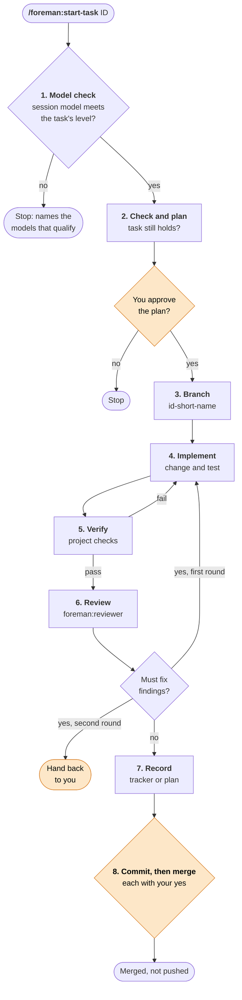

# foreman

**Assign each task to the right model. Review every change before it merges.**

[](LICENSE)
[](https://claude.com/claude-code)


foreman is a small, opinionated workflow for building software with AI
coding agents. Like a foreman on site, it gives each job to a worker of
the right grade, then inspects the work before it is signed off:

- **One task, one branch.** Every task from your plan or audit tracker
  gets its own branch, review and merge.
- **The right model for the task.** Each task carries a level (A, B, C
  or Human). A cheap model does mechanical work; risky work needs a
  strong one. foreman stops before reading any code if the session
  model is too weak.
- **An independent review.** A fixed, strong, read-only reviewer checks
  every branch, whichever model wrote it, so a cheap model never marks
  its own homework.
- **You stay in charge.** Nothing is written before you approve the
  plan, nothing is committed or merged without your yes, and nothing is
  ever pushed.

foreman does one part of development only: taking a single task through
to a merge. It does not write your plan or run audits.

## Contents

- [How it works](#how-it-works)
- [Model levels](#model-levels)
- [Installation](#installation)
- [Quick start](#quick-start)
- [Project files](#project-files)
- [Repository layout](#repository-layout)
- [Roadmap](#roadmap)
- [Maintenance](#maintenance)
- [Licence and credits](#licence-and-credits)

## How it works

`/foreman:start-task <id> [notes]` takes a finding (`F01`) or a plan
task (`5.2`) through eight steps. The amber steps wait for you.



| Step | What happens |
|---|---|
| 1. Model check | Reads only the task's level. Stops if the session model is below it, not placed in the table, or on trial for another task. |
| 2. Check and plan | Confirms the task still applies, then proposes the change, the files and the guarding test. |
| 3. Branch | `<id>-<short-name>` from a clean main branch. |
| 4. Implement | The smallest complete change, plus its test. |
| 5. Verify | Runs the project's checks (tests, lint, types) and fixes what fails. |
| 6. Review | `foreman:reviewer` on `claude-opus-5-5`, read-only. Must fix items are fixed and reviewed once more; if any remain, it hands back to you. Items that can wait become new findings. |
| 7. Record | Moves the finding to Implemented, or ticks the plan task with the date. |
| 8. Commit and merge | Shows the diff and message (`F01: ...`), then asks before committing and again before merging. |

## Model levels

Each task's level is written on it by whoever raised it, never guessed
by the model about to do it. The highest matching level wins.

| Level | For | Claude Code model |
|---|---|---|
| A | Irreplaceable data, production systems, money or date logic, changes across modules, judgement | Opus 5.5 |
| B | One function, with the change and its test spelled out | Sonnet 5.5 |
| C | Deleting or moving code, checked by the full test suite | Haiku 5.5 |
| Human | A decision from outside the code comes first | then A, B or C |

The full table, with OpenAI and local models, the reviewer settings and
tested behaviour, is in [`shared/model-levels.md`](shared/model-levels.md).
It ships with the plugin; to see the installed copy from any project,
run:

```
/foreman:models
```

## Installation

### Requirements

- [Claude Code](https://claude.com/claude-code)
- git
- Recommended: the [ponytail](https://github.com/DietrichGebert/ponytail)
  plugin. The reviewer uses its `ponytail-review` skill when available
  and applies the same checks itself when not; `/ponytail:ponytail-audit`
  is a good way to fill the tracker.

### Claude Code

At the prompt of a terminal session:

```
/plugin install foreman --marketplace RoccoNaude/foreman
```

Answer `y` to add the marketplace, then choose a scope. Or from a shell:

```
claude plugin install foreman --marketplace RoccoNaude/foreman
```

## Quick start

1. **Add the settings.** Copy
   [`shared/templates/settings.md`](shared/templates/settings.md) to
   `.foreman.md` at your repository root and fill it in.
2. **Add a tracker, a plan or both** from
   [`shared/templates/`](shared/templates/).
3. **Commit them,** start a session on a model that meets the task's
   level, and run:

   ```
   /foreman:start-task F01
   ```

## Project files

foreman keeps everything general in the plugin and everything about your
project in a few Markdown files you own. Each template opens with a
short note on what the file is for.

| File in your project | Template | Purpose |
|---|---|---|
| `.foreman.md` | [`settings.md`](shared/templates/settings.md) | Paths, checks, protected data, actions that need approval, extra level A cases |
| Audit tracker | [`code-audit.md`](shared/templates/code-audit.md) | Faults in code that already exists: `F01`, `F02`, ... |
| Implementation plan | [`implementation-plan.md`](shared/templates/implementation-plan.md) | New work, in phases: `1.1`, `5.2`, ... |
| Workflow ADR | [`adr-ai-assisted-development-workflow.md`](shared/templates/adr-ai-assisted-development-workflow.md) | Why the project uses this workflow |

> **Finding or plan task?** If it is broken now, it is a finding. If it
> does not exist yet, it is a plan task.

## Repository layout

```
foreman/
├── .claude-plugin/       Claude Code manifest and marketplace file
├── claude-code/
│   ├── commands/         start-task, models
│   └── agents/           reviewer
├── .opencode/plugins/    OpenCode V2 entrypoint and implementation
├── tests/               OpenCode package and runtime checks
└── shared/               tool-neutral Markdown
    ├── model-levels.md
    └── templates/
```

## Roadmap

- **Claude Code:** available.
- **OpenCode V2:** [package foundation](.opencode/README.md) available for
  development; commands and reviewer are not implemented yet. Reuses `shared/`.
- **Hermes Agent:** planned, not yet researched.

## Maintenance

Check [`shared/model-levels.md`](shared/model-levels.md) monthly, or when
a new model appears. Change the reviewer's model ID in
[`claude-code/agents/reviewer.md`](claude-code/agents/reviewer.md) in the
same commit as the table, so the history shows which reviewer approved
which change.

### Releasing a change

Claude Code caches each installed plugin by its version, so users only
receive a change when the version goes up. For every change users should
get:

1. Raise `version` in [`.claude-plugin/plugin.json`](.claude-plugin/plugin.json)
   (patch for fixes, minor for new behaviour) and the badge at the top of
   this file, in the same commit as the change or straight after it.
2. Merge to `master` and push.

### Updating an installed copy

From a shell:

```
claude plugin marketplace update foreman
claude plugin update foreman@foreman
```

Or run `/plugin` in Claude Code, refresh the foreman marketplace and
update the plugin. Restart Claude Code afterwards. One update covers
every project when the plugin is installed at user scope; a project
scope install is updated from that project.

## Licence and credits

Released under the [MIT Licence](LICENSE).

Designed by [Rocco Naudé](https://github.com/RoccoNaude) and built with
[Claude Code](https://claude.com/claude-code). Commits written with
Claude carry a `Co-Authored-By: Claude` trailer.
