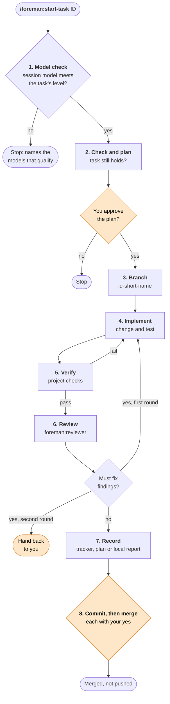

# foreman

**Assign each task to the right model. Review every change before it merges.**

[](LICENSE)
[](https://claude.com/claude-code)


foreman is a small, opinionated workflow for building software with AI
coding agents. Like a foreman on site, it gives each job to a worker of
the right grade, then inspects the work before it is signed off:

- **One task, one branch.** Every task from your plan, audit tracker or GitHub issues
  gets its own branch, review and merge.
- **The right model for the task.** Each task carries a level (A, B, C
  or Human). A cheap model does mechanical work; risky work needs a
  strong one. foreman stops before reading any code if the session
  model is too weak.
- **An independent review.** A fixed, strong, read-only reviewer checks
  every branch, whichever model wrote it, so a cheap model never marks
  its own homework.
- **You stay in charge.** Nothing is written before you approve the
  plan, nothing is committed or merged without your yes, and nothing is
  ever pushed.

foreman does one part of development only: taking a single task through
to a merge. It does not write your plan or run audits.

## Contents

- [How it works](#how-it-works)
- [Model levels](#model-levels)
- [Installation](#installation)
- [Quick start](#quick-start)
- [Project files](#project-files)
- [Repository layout](#repository-layout)
- [Roadmap](#roadmap)
- [Maintenance](#maintenance)
- [Licence and credits](#licence-and-credits)

## How it works

`/foreman:start-task <id> [notes]` (Claude Code) or
`/foreman/start-task <id> [notes]` (OpenCode) takes a finding (`F01`) or a plan
task (`5.2`), or `issue <number|#number|URL>` through eight steps. The amber steps wait for you.

```text
/foreman:start-task issue 42
/foreman:start-task issue #42 Focus on the import failure
/foreman/start-task issue https://github.com/owner/repo/issues/42
```

> **OpenCode usage note:** if slash commands submit immediately or produce no
> response in Zed / ACP, type an ordinary message **without a leading `/`**:
> `foreman start-task 7.8` or `foreman models` (requires foreman 0.2.1+).
> Both plain prompts have been confirmed working in Zed; OpenCode TUI slash
> commands continue to work normally. See the [ACP workaround](.opencode/README.md#zed--acp-workaround)
> for task references, optional notes and limitations.

Numbers use the checkout's GitHub repository; URLs identify it explicitly.
Ambiguous repositories and cross-repository work need clarification. Issue
access requires an available GitHub connector or authenticated `gh` (only for
issue tasks). Inaccessible issues, closed issues, pull-request URLs and unclear
acceptance criteria stop for clarification. Text after the complete reference
is your notes; existing finding/plan syntax is unchanged.

An optional `Model: A|B|C|Human (then X)` line in the issue body supplies
the level; if missing, foreman asks you, never estimates. Invalid or conflicting
levels also need clarification. Issues remain their own task source: no local
plan/tracker copy is required. Completion is reported locally; foreman does not
comment on, edit or close issues without separate explicit approval, and avoids
automatic-closing commit text. See [shared issue rules](shared/github-issues.md).



| Step | What happens |
|---|---|
| 1. Model check | Reads only the task's level. Stops if the session model is below it, not placed in the table, or on trial for another task. |
| 2. Check and plan | Confirms the task still applies, then proposes the change, the files and the guarding test. |
| 3. Branch | `<id>-<short-name>` from a clean main branch. |
| 4. Implement | The smallest complete change, plus its test. |
| 5. Verify | Runs the project's checks (tests, lint, types) and fixes what fails. |
| 6. Review | Independent `foreman:reviewer` on `claude-opus-5-5` (Claude Code), or `foreman-reviewer` on `openai/gpt-6.1-sol#high` (OpenCode). `ponytail-review` is the primary path. OpenCode permits disclosed manual fallback only when the skill is unavailable; a skill execution failure blocks approval. Claude Code also permits fallback when the skill cannot run. Must fix items are fixed and reviewed once more; if any remain, it hands back to you. Items that can wait become new findings. |
| 7. Record | Moves the finding to Implemented, ticks the plan task with the date, or reports issue completion locally without changing GitHub. |
| 8. Commit and merge | Shows the diff and message (`F01: ...`), then asks before committing and again before merging. |

## Model levels

Each task's level is written on it by whoever raised it, never guessed
by the model about to do it. The highest matching level wins.

| Level | For | Claude Code model |
|---|---|---|
| A | Irreplaceable data, production systems, money or date logic, changes across modules, judgement | Opus 5.5 |
| B | One function, with the change and its test spelled out | Sonnet 5.5 |
| C | Deleting or moving code, checked by the full test suite | Haiku 5.5 |
| Human | A decision from outside the code comes first | then A, B or C |

The full table, with OpenAI and local models, the reviewer settings and
tested behaviour, is in [`shared/model-levels.md`](shared/model-levels.md).
It ships with the plugin; to display only its models-per-level table from
any project, run:

```
/foreman:models
```

In OpenCode, use `/foreman/models` instead.

For Zed / ACP, use `foreman models` without `/`; see the
[usage note above](#how-it-works).

## Installation

### Requirements

- [Claude Code](https://claude.com/claude-code) or OpenCode V2 (tested **2.2.5**, not V1)
- git
- Recommended: the [ponytail](https://github.com/DietrichGebert/ponytail)
  plugin. The reviewer uses its `ponytail-review` skill when available
  and applies the same checks itself when not; `/ponytail:ponytail-audit`
  is a good way to fill the tracker.

### Claude Code

At the prompt of a terminal session:

```
/plugin install foreman --marketplace RoccoNaude/foreman
```

Answer `y` to add the marketplace, then choose a scope. Or from a shell:

```
claude plugin install foreman --marketplace RoccoNaude/foreman
```

### OpenCode V2

Requires access to `openai/gpt-6.1-sol#high` for the reviewer, plus a task-qualified
implementation model. Install `ponytail-review` separately in OpenCode; Claude
Code's plugin skills are not automatically shared. Node.js/npm are needed for
the tarball route and development checks, not an SDK or build step.

Global Git installation (supported by OpenCode; no npm publication required):

```sh
opencode plugin add github:RoccoNaude/foreman
```

This follows the repository's default branch. For reproducibility use
`github:RoccoNaude/foreman#<full-commit-hash>` with a reviewed commit. The CLI
changes global configuration; run it only if you want foreman in every project.
The package is **not published to npm**; install from Git or a local tarball.
`"private": true` in `package.json` prevents accidental npm publication; it does
not make this public GitHub repository private. Git installation uses
the contents of the selected revision, not unmerged work in this checkout.

For project-local use, merge this into `opencode.jsonc` at the project root:

```jsonc
{
  "$schema": "https://opencode.ai/config.json",
  "plugins": ["github:RoccoNaude/foreman"]
}
```

The same `plugins` entry in `~/.config/opencode/opencode.jsonc` (or
`$XDG_CONFIG_HOME/opencode/opencode.jsonc`) is the manual global alternative.
Preserve unrelated settings. For the **installed-directory tarball route tested
in step 4**, checkout discovery, update/removal and security limits, see the
[OpenCode guide](.opencode/README.md).

## Quick start

1. **Add the settings.** Copy
   [`shared/templates/settings.md`](shared/templates/settings.md) to
   `.foreman.md` at your repository root and fill it in.
2. **Choose a task source:** add a tracker, a plan or both from
   [`shared/templates/`](shared/templates/), or use GitHub issues. For
   issue-only work, Tracker and Plan can both be `None` in `.foreman.md`.
3. **Commit them,** start a session on a model that meets the task's
   level, and run:

   ```
    /foreman:start-task F01
    ```

   In OpenCode use `/foreman/start-task F01`. Put project rules and check commands
   in `AGENTS.md`; do not assume Claude Code memories or `CLAUDE.md` are loaded.
   Wait for plan approval, then approve commit and merge separately. These are
   model instructions, not hard security controls.

## Project files

foreman keeps everything general in the plugin and everything about your
project in a few Markdown files you own. Each template opens with a
short note on what the file is for.

| File in your project | Template | Purpose |
|---|---|---|
| `.foreman.md` | [`settings.md`](shared/templates/settings.md) | Paths, checks, protected data, actions that need approval, extra level A cases |
| Audit tracker | [`code-audit.md`](shared/templates/code-audit.md) | Faults in code that already exists: `F01`, `F02`, ... |
| Implementation plan | [`implementation-plan.md`](shared/templates/implementation-plan.md) | New work, in phases: `1.1`, `5.2`, ... |
| Workflow ADR | [`adr-ai-assisted-development-workflow.md`](shared/templates/adr-ai-assisted-development-workflow.md) | Why the project uses this workflow |

> **Finding or plan task?** If it is broken now, it is a finding. If it
> does not exist yet, it is a plan task.

GitHub issues can describe either kind of work without duplicating it in these
files. `.foreman.md` is still required for issue tasks; its checks and safeguards
apply unchanged. The reviewer receives the issue snapshot and your clarifications.

## Repository layout

```
foreman/
├── .claude-plugin/       Claude Code manifest and marketplace file
├── claude-code/
│   ├── commands/         start-task, models
│   └── agents/           reviewer
├── .opencode/plugins/    OpenCode V2 entrypoint and implementation
├── .opencode/README.md   OpenCode installation and maintenance
├── package.json          OpenCode npm package metadata (private)
├── AGENTS.md             Repository contributor instructions
├── opencode/             Historical implementation notes (not packaged)
├── tests/               OpenCode package and runtime checks
└── shared/               tool-neutral Markdown
    ├── model-levels.md
    └── templates/
```

## Roadmap

- **Claude Code:** available.
- **OpenCode V2:** commands and independent skill-first reviewer implemented;
  [installed-package acceptance](tests/README.md) passed on 2.2.5.
  Not published to npm; Git and local installation supported.
  Reuses `shared/` directly. Newer OpenCode versions are unverified.
- **Hermes Agent:** planned, not yet researched.

## Maintenance

Check [`shared/model-levels.md`](shared/model-levels.md) monthly, or when
a new model appears. Change the reviewer's model ID in
[`claude-code/agents/reviewer.md`](claude-code/agents/reviewer.md) in the
same commit as the table, so the history shows which reviewer approved
which change. For OpenCode, change the `reviewerModel` constant in
`.opencode/plugins/foreman.mjs` and its test expectations instead. See
[OpenCode maintenance](.opencode/README.md#maintenance-and-release).

### Releasing a Claude Code change

Claude Code caches each installed plugin by its version, so users only
receive a change when the version goes up. For every change users should
get:

1. Raise `version` in [`.claude-plugin/plugin.json`](.claude-plugin/plugin.json)
   (patch for fixes, minor for new behaviour) and the badge at the top of
   this file, in the same commit as the change or straight after it.
2. Merge to `master` and push.

The integrations have separate versions: `.claude-plugin/plugin.json` for
Claude Code, root `package.json` for OpenCode. Shared-asset changes affect both,
so bump both versions and their badges; integration-only changes need only that
integration's bump. Current versions appear in the badges above and their
respective manifests. Editing metadata does not publish either integration.
Commit/push, PR/merge, tags and publication require owner
approval under the repository's contribution agreement.

### Updating an installed copy

From a shell:

```
claude plugin marketplace update foreman
claude plugin update foreman@foreman
```

Or run `/plugin` in Claude Code, refresh the foreman marketplace and
update the plugin. Restart Claude Code afterwards. One update covers
every project when the plugin is installed at user scope; a project
scope install is updated from that project.

## Licence and credits

Released under the [MIT Licence](LICENSE).

Designed by [Rocco Naudé](https://github.com/RoccoNaude) and built with
[Claude Code](https://claude.com/claude-code). Commits written with
Claude carry a `Co-Authored-By: Claude` trailer.
